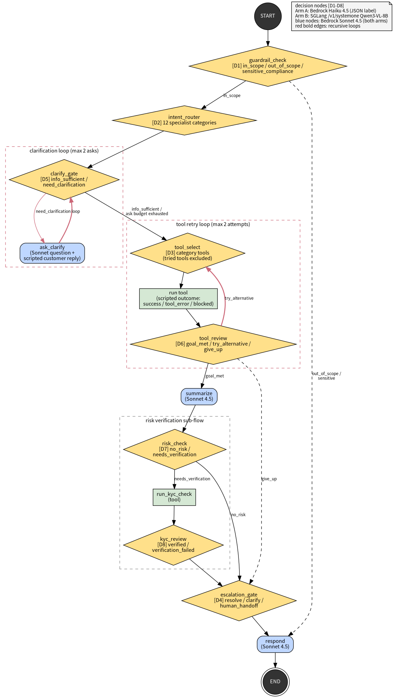
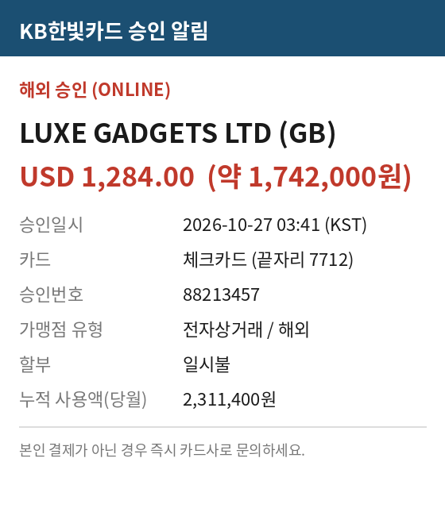
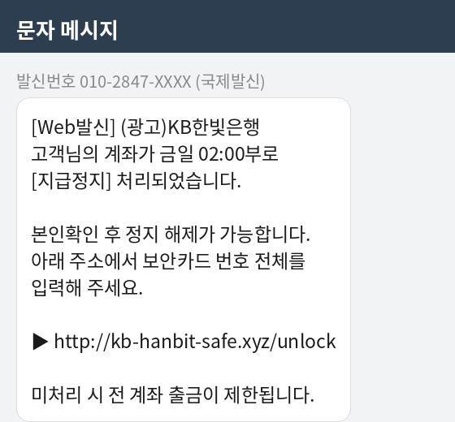
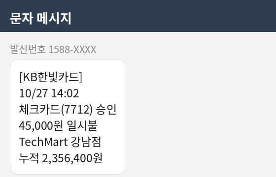

# Workshop 가이드: 한국어 금융 상담 Agent의 Decision Layer 실습 (SGLang + Qwen3-VL)

- 작성일: 2026-10-27 (파일명 prefix는 서울 시간(KST, UTC+9) 기준 202610271814, 구버전 202610271757 대체)
- 구성: **시나리오 A** — 다단계·recursive LangGraph workflow에 한국어로 질의 / **시나리오 B** — 스크린샷 이미지를 읽는 판단 (Qwen3-VL)
- 실습 형태: **Jupyter notebook** — 노트북은 두 언어로 제공: `[KR]_`(한국어) / `[EN]_`(영어) prefix. 5부작+확장 (`workshop/01~05_*.ipynb`, kernel: `Python (agent venv)`) — 전부 실행 검증 완료(오류 0), 노트북별 `_solution.ipynb`(실행 완료본) 동봉
- 측정 환경: AWS EC2 us-west-2, NVIDIA H100, SGLang v0.5.21 + Qwen3-VL-8B-Instruct (:8001, triton backend) vs Amazon Bedrock Haiku 4.5 (`us.` cross-region profile). 응답 생성은 양쪽 모두 Bedrock Sonnet 4.5
- 모든 은행/카드/금액/스크린샷은 합성 데이터입니다(가상의 "KB한빛")

---

## 1. Workshop 한 장 요약

| 구분 | 내용 | 핵심 수치 (실측) |
|---|---|---|
| 시나리오 A | 한국어 질의 3건을 recursive workflow로 처리, 결정 backend만 교체 | 결정 latency 합계 **5.2-7.9초 -> 0.28-0.31초 (약 19배)** |
| 시나리오 B | 승인 알림·문자 스크린샷을 모델이 직접 읽고 판정 | 이미지 판단 **94-117ms vs 0.85-1.7초 (약 9-15배)** |
| 공통 교훈 | 안전 판단(D1 guardrail)은 소형 decision model이 과차단 | 한국어 피해 신고 표현을 **conf 1.0으로 오차단** -> hybrid 권고 |

전달 메시지: "응답을 생성하는 LLM은 그대로 두고, **판단만 decision layer로 옮기면** agent의 사고 시간에서 판단 몫이 사실상 사라진다. 이미지 증빙까지 같은 GPU의 Qwen3-VL이 100ms 안팎에 읽는다."

## 2. 실행 방법

```bash
# 0. SGLang 서버 (H100 박스)
HF_HOME=/data/hf-cache \
CUDA_HOME=/data/venvs/sglang/lib/python3.12/site-packages/nvidia/cu13 \
/data/venvs/sglang/bin/python -m sglang.launch_server \
  --model-path Qwen/Qwen3-VL-8B-Instruct --port 8001 \
  --mem-fraction-static 0.75 --attention-backend triton --enable-multimodal

# 1. 시연용 합성 이미지 (최초 1회)
python3 scripts/92_make_workshop_images.py

# 2-a. Jupyter notebook 실습 (권장) — 주제별 폴더를 순서대로
#   kernel "Python (agent venv)" 선택 (/data/venvs/agent, ipykernel 등록 완료)
jupyter lab workshop/
```

폴더 구성(주제별, 각 노트북에 실행 완료본 `_solution.ipynb` 동봉, 대목차는 `workshop/README.md`):

| 폴더 | 내용 |
|---|---|
| `10_agent_foundation/` | 01 — LangGraph step-by-step 조립(단계별 그래프 시각화) |
| `20_text_scenarios/` | 02-04 — 한국어 상담 3종(되묻기 loop / tool 재시도 / KYC) Haiku vs SGLang |
| `30_image_scenarios/` | 05 — 스크린샷 판독(Qwen3-VL) |
| `40_other_deciders/` | 06 Bedrock Intelligent Prompt Routing(Nova 라이브), 07 strands-decider(2B, :8002), 08 Laya(322M, in-process) |

| 노트북 | 내용 | 실측 (solution 기준) |
|---|---|---|
| `[KR]_01_build_agent.ipynb` (영문판 `[EN]_01_build_agent.ipynb`) | LangGraph step-by-step 구성: State -> 결정 backend 2종 단건 체험 -> 노드 하나씩 정의 -> loop/분기 wiring -> 시험 구동 | 구성 후 1건 e2e 7.3초 (결정 252ms) |
| `[KR]_02_scenario1_clarify.ipynb` (영문판 `[EN]_02_scenario1_clarify.ipynb`) | 예제 1: 모호한 문의 -> clarification loop. Haiku 실행 -> SGLang 실행 -> 비교 | 결정 6,574 -> 304ms (**21.6x**) |
| `[KR]_03_scenario2_retry.ipynb` (영문판 `[EN]_03_scenario2_retry.ipynb`) | 예제 2: 해외송금 미도착 -> tool 오류 -> 재시도 loop | 결정 8,471 -> 331ms (**25.6x**) |
| `[KR]_04_scenario3_risk_kyc.ipynb` (영문판 `[EN]_04_scenario3_risk_kyc.ipynb`) | 예제 3: 이상거래 flag -> KYC sub-flow + guardrail 과차단 probe 재현 셀 | 결정 6,656 -> 302ms (**22.1x**) |
| `[KR]_05_scenario4_image.ipynb` (영문판 `[EN]_05_scenario4_image.ipynb`) | 예제 4: 승인 알림·문자 스크린샷을 읽는 판단 4종 | p50 합계 3,906 -> 420ms (**9.3x**) |

각 시나리오 노트북은 `ws_common.run_verbose()`가 그래프 노드 실행을 스트리밍으로 받아 **"STEP n ▶ 노드명 — 역할"** 과 판정 label/confidence/latency, 되묻는 질문·고객 답변·최종 응답을 단계별로 출력합니다 — 느린 Haiku arm에서는 STEP이 하나씩 찍히는 것 자체가 시연 효과입니다.

```bash
# 2-b. CLI 일괄 실행 (notebook 없이 수치만)
/data/venvs/agent/bin/python scripts/94_workshop_workflow_demo.py   # 시나리오 A
/data/venvs/agent/bin/python scripts/93_workshop_demo.py --reps 10  # 판단 단위 반복 측정
```

notebook 전체 실행 비용은 약 $0.5(Bedrock)이며, 결과는 `results/summary/workshop_workflow.json`(A), `workshop_latency.json`(반복 측정)에 저장됩니다.

---

## 3. 시나리오 A — 복잡한 workflow에 한국어로 질의

실습 대상 workflow는 결정 노드 8종(D1 guardrail / D2 routing / D5 clarify gate / D3 tool 선택 / D6 tool review / D7 risk / D8 KYC / D4 escalation), **recursive loop 2개**(clarification, tool retry), 조건부 KYC sub-flow로 구성된 은행 상담 agent입니다(`agent/graph_v2.py`). 두 arm은 topology와 응답 생성(Sonnet 4.5)이 완전히 같고 **결정 backend만** 다릅니다.



한국어 질의 3건이 각각 workflow의 대표 경로를 하나씩 통과합니다 (`scripts/94`, warm-up 1회 후 측정):

### A-1. "카드가 안 긁히는데 어떻게 해야 하나요?" — clarification loop

모호한 문의여서 agent가 D5에서 need_clarification을 판정하고, Sonnet이 한국어로 되묻는 질문을 생성 -> (scripted) 고객 답변 수신 -> 재판정 후 진행합니다.

| 지표 | Arm A (Haiku 결정) | Arm B (SGLang 결정) |
|---|---|---|
| 결정 8회 합계 | 5,473ms | **284ms (19.3x)** |
| e2e (생성 포함) | 15,923ms | 13,723ms |

### A-2. "어제 보낸 해외송금이 아직 도착하지 않았어요 (TR-20261026-8841, USD 2,000)" — tool retry loop

첫 tool(track_transfer)이 시스템 오류를 반환하면 D6이 결과를 읽고 try_alternative를 판정, 대체 tool로 재시도해 복구합니다.

| 지표 | Arm A | Arm B |
|---|---|---|
| 결정 9회 합계 | 5,790ms | **311ms (18.6x)** |
| e2e | 16,588ms | 10,030ms |

### A-3. "해외 결제(USD 1,284, LUXE GADGETS) 승인 알림을 받았는데, 이 거래를 확인하고 싶어요" — KYC sub-flow

tool 성공 결과에 fraud/AML 모니터링 flag가 붙어 있고, D7이 이를 감지하면 KYC 재검증 tool 실행 -> D8 판정을 거쳐 종결합니다.

| 지표 | Arm A | Arm B |
|---|---|---|
| 결정 8회 합계 | 5,171ms | **283ms (18.3x)** |
| e2e | 16,199ms | 10,531ms |

시연 포인트:

- 결정 1회당 Haiku 약 640ms vs SGLang 약 33-36ms. **결정이 많고 loop가 도는 workflow일수록 격차가 커집니다** (단순 4-decision v1보다 recursive v2에서 체감이 큼).
- notebook의 타임라인 출력은 노드별 latency에 D(결정)/L(생성)/T(tool) 표시와 SGLang confidence를 함께 보여줘, "판단은 즉답·생성만 남는다"를 시각적으로 전달합니다.
- **guardrail 교보재 (A-3 문구 선정 배경)**: "제가 쓰지 않은/모르는 해외 결제" 류 피해 신고 표현 4종을 probe한 결과, Qwen3-VL-8B의 D1이 3종을 **confidence 1.000으로 sensitive_compliance 과차단**했습니다 (Haiku는 전부 in_scope). confidence가 포화되어 threshold로도 거를 수 없는 유형이므로, **안전 판단(D1)은 상위 모델 유지 또는 상위 모델 fallback의 hybrid 구성**이 필요하다는 결론으로 연결하세요. (160건 실측: `../research/202610271445_agent_decision_ab_report.md`)

## 4. 시나리오 B — 스크린샷 이미지를 읽는 판단 (Qwen3-VL)

v0.5.21의 `/v1/systemone`에는 이미지 입력이 없어, 이미지 판단은 `/v1/chat/completions`(max_tokens 64, JSON label 강제)를 사용합니다. 합성 스크린샷 3종은 `scripts/92`가 생성합니다.



### B-1. "이 승인 알림, 제가 결제한 게 아니에요" — 증빙 유형·사건 분류

정답(unauthorized_**overseas**_payment)을 내려면 스크린샷의 "해외 승인 (ONLINE)" 문구·금액·가맹점을 모델이 직접 읽어야 합니다. (10회 반복 p50, `scripts/93`)

| 판단 | SGLang Qwen3-VL | Haiku | 결과 |
|---|---|---|---|
| 증빙 유형 (5지) | **96.3ms** | 1,007.4ms | 둘 다 card_approval_notice 10/10 |
| 사건 분류 (4지) | **116.9ms** | 1,046.5ms | 둘 다 unauthorized_overseas_payment 10/10 |

### B-2. "은행에서 이런 문자가 왔는데 눌러야 하나요?" — 피싱 판별





| 입력 (정답) | SGLang Qwen3-VL | Haiku | 판별 |
|---|---|---|---|
| 피싱 문자 (phishing_suspected) | **109.7ms** | 969.9ms | 둘 다 10/10 정답 |
| 정상 문자 (legitimate_notice) | **94.2ms** | 845.9ms | **Qwen 10/10, Haiku 8/10** (notebook 재실행에서도 Haiku 오판 재현) |

시연 포인트: 피싱 판별은 고객이 링크를 누르기 전에 판정이 도착해야 하는 업무라 100ms vs 1초가 보안 효과의 차이가 됩니다. 이 케이스에서는 self-hosted 8B VLM이 속도뿐 아니라 판별 일관성에서도 앞섰습니다(n=10 참고치).

## 5. 다른 decision/routing 제품과의 비교 (40_other_deciders)

- **Bedrock Intelligent Prompt Routing(06)**: 판단이 아니라 **생성 모델 선택**. `converse()`에 router ARN을 넣으면 요청 난이도에 따라 Nova Lite/Pro를 골라줍니다(실측: 쉬운 FAQ→Lite, 송금 상담→Pro). 과금 $1/1,000건 + 토큰. Claude 계열은 default router 멤버(3.x)가 EOL이고 4.5는 미지원이라 Nova로 실습. decision layer와는 보완재.
- **strands-decider(07)**: Strands 팀의 2B 전용 decision model. `/v1/systemone` 서빙이라 기존 client에 port만 바꿔 LangGraph에 그대로 연결. calibrated confidence(자신 없는 판단을 낮은 conf로 정직하게 노출)가 강점.
- **Laya(08)**: 오픈소스 다국어 System 1 engine(322M, CPU 가능). Python native `Router` + 20줄 adapter로 연결. 11지 이상 choice confidence는 uncalibrated 경고.

**한국어 판단 품질 실측** (이 워크샵 160건 D1/D2 전수, `scripts/95_decider_quality_bench.py`):

| backend | D1 (3지) | D2 strict/lenient (12지) | p50 |
|---|---|---|---|
| SGLang Qwen3-VL-8B | **0.913** | **0.629 / 0.707** | 33ms |
| strands-decider 2B | 0.613 | 0.500 / 0.593 | 85ms |
| Laya multilingual 322M | 0.419 | 0.357 / 0.379 | 21ms |

해석: 언어 특화보다 **모델 용량이 품질 상한을 지배**(8B > 2B > 0.3B). 소형 전용 모델은 zero-shot이 아니라 fine-tuning이 전제입니다(Laya 공식: 튜닝 시 0.362→0.766). 이미지 판단은 Qwen3-VL만 가능합니다.

## 6. 수치 해석 시 유의점

- 데모/소표본 측정입니다(시나리오 A는 1회 실행, B는 10회 반복). 모수 기반 수치는 160건 A/B 실측 보고서와 함께 제시하세요 (v1: `../research/202610271445_agent_decision_ab_report.md`, 한국어 다단계 v2: 실측 완료 후 발행 예정).
- SGLang은 localhost 호출(동일 VPC 서빙 가정), Bedrock은 us-west-2 리전 호출입니다. e2e의 생성(LLM) 시간은 Sonnet 변동에 따라 ±수 초 흔들리지만 결정 latency 격차는 일정합니다.
- "이미지 생성" 요소는 모델이 아니라 재현 가능한 합성 fixture(`scripts/92`, PIL)로 구현했습니다 — Qwen3-VL은 이미지 이해 전용입니다.
